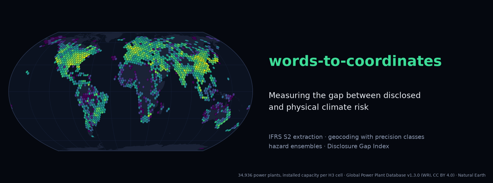
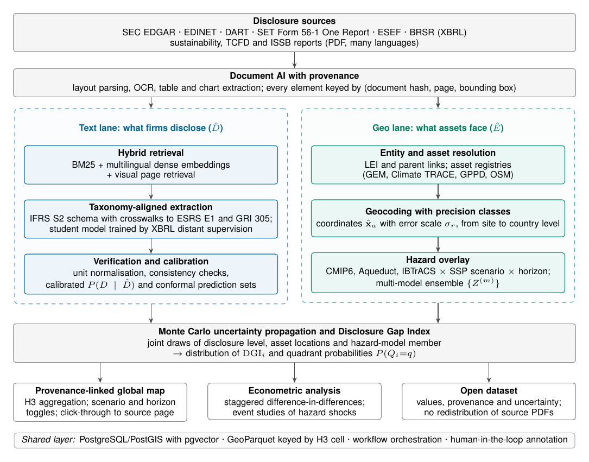
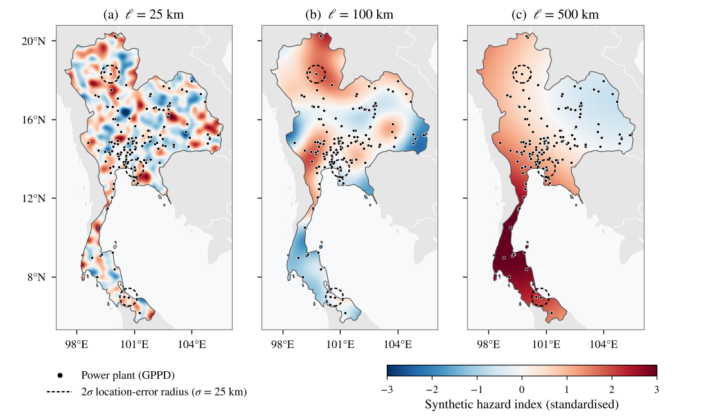
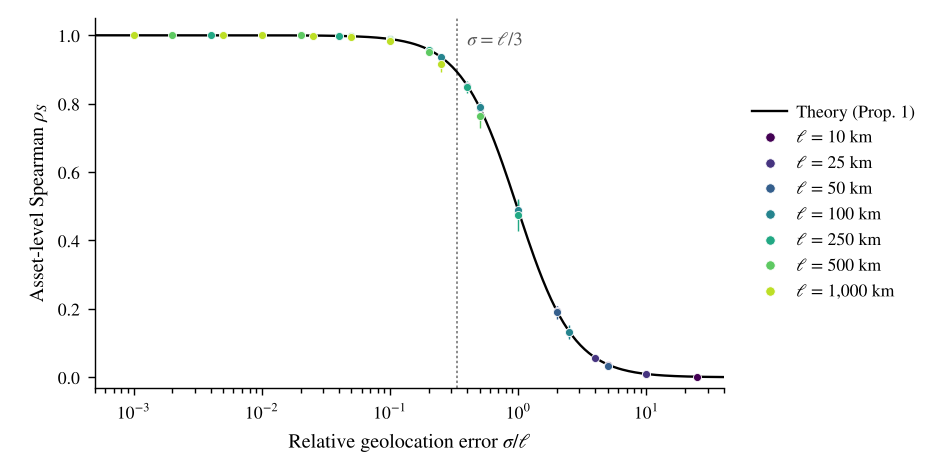

<p align="center"><a href="https://thanatchon36.github.io/words-to-coordinates/paper/"></a></p>

<p align="center">
<a href="https://github.com/thanatchon36/words-to-coordinates/actions/workflows/ci.yml"></a>
<a href="pyproject.toml"></a>
<a href="https://thanatchon36.github.io/words-to-coordinates/paper/"></a>
<a href="paper/paper.pdf"></a>
<a href="#data-sources"></a>
<a href="LICENSE"></a>
</p>

<p align="center">
📖 <b><a href="https://thanatchon36.github.io/words-to-coordinates/paper/">Read the paper online</a></b> ·
📄 <b><a href="paper/paper.pdf">Download the PDF</a></b> ·
📊 <b><a href="results/results.json">Results</a></b> ·
🗂️ <b><a href="#data-sources">Data sources</a></b> ·
📝 <b><a href="CHANGELOG.md">Changelog</a></b>
</p>

**Words to Coordinates (W2C): an uncertainty-aware NLP–geospatial framework for measuring the gap between
disclosed and physical climate risk.** W2C links *what firms disclose* to *what their assets face*: a text lane
extracts taxonomy-aligned climate disclosures (IFRS S2, with crosswalks to ESRS E1 and GRI 305) with page-level
provenance, a geo lane resolves assets to coordinates with explicit precision classes and overlays them with
hazard-model ensembles, and the **Disclosure Gap Index (DGI)** places every firm in one of four quadrants —
*aware*, *silent risk*, *cheap talk* and *benign* — with a calibrated probability.



> **Simulation data notice.** Only the asset locations (Global Power Plant Database v1.3.0) are real. Hazard
> fields, disclosure levels and extraction errors in the simulation study are synthetic. Owner names are used only to
> group plants into pseudo-firms, and no result refers to any real company.

## Install and quickstart

```bash
make setup         # uv venv + dependencies (Python 3.12)
make test          # 15 unit tests, no downloaded data needed
make data          # download GPPD v1.3.0 and Natural Earth boundaries into data/
make experiments   # optional: rerun E1–E3 (about 6 minutes)
make all           # figures -> table -> paper -> web reader
```

Cached results are included in `results/`, so figures, the results table and the paper rebuild without rerunning
the experiments. Without `uv`: `pip install -r requirements.txt pytest`, then `make <target> PY=python3`.

| Target | Purpose |
|---|---|
| `setup` | Create `.venv` with uv and install the dependencies from `pyproject.toml` |
| `data` | Download GPPD v1.3.0 and Natural Earth boundaries into `data/` (git-ignored) |
| `experiments` | Run E1–E3 with `code/run_parts.py` (resumable, seeded per unit) and merge into `results/results.json` |
| `figures` | `paper/figs/*.pdf` and the PNG previews in `assets/` |
| `banner` | README banner → `docs/assets/banner.png` |
| `table` | `paper/tab_e3.tex` from `results/results.json` |
| `paper` | Compile `paper/paper.pdf` (pdflatex + bibtex) |
| `web` | Web reader → `docs/paper/index.html` (pandoc), served at <https://thanatchon36.github.io/words-to-coordinates/paper/> |
| `test` | Unit tests for the simulation library and the web reader build |

## What the framework does

1. **Ingestion and document AI** — filings and voluntary reports from regulatory repositories, parsed once with
   layout-aware conversion; every element is keyed by (document hash, page, bounding box).
2. **Taxonomy-aligned extraction** — hybrid retrieval (BM25, multilingual dense embeddings, visual page retrieval)
   into a typed schema anchored on IFRS S2, with XBRL-tagged filings as distant supervision for non-English markets.
3. **Verification and calibration** — deterministic checks plus a calibrated distribution P(D | D̂) for the ordinal
   disclosure level, with split-conformal prediction sets.
4. **Entity resolution and geocoding** — LEI-based parent–subsidiary resolution, matching to open asset registries,
   and a precision class with an empirical error scale σ for every location.
5. **Hazard overlay** — hazard layers per scenario and horizon, with ensemble members kept separate and H3 cells as
   the common spatial index.
6. **Uncertainty propagation** — Monte Carlo draws of hazard member, asset locations and disclosure levels give a
   probability for each quadrant and an interval for the DGI.

## Key results (simulation study)

The paper derives a closed-form relation between geolocation error σ and the correlation between true and estimated
hazard exposure for a hazard with spatial correlation length ℓ: **Corr = ℓ² / (ℓ² + σ²)**, which implies the design rule
**σ ≤ ℓ/3** to preserve a correlation of 0.9. Using the real locations of 11,107 power plants held by 1,247 owners in
76 countries:

| Finding | Result |
|---|---|
| Theory vs. simulation (49 combinations of ℓ and σ) | mean absolute deviation 0.002 |
| Country-level geocoding, firm-level rank correlation | ≤ 0.11 for ℓ ≤ 100 km; at most 0.54 for ℓ = 1,000 km |
| Local hazard (ℓ = 25 km): city-level location error (σ = 25 km) | quadrant accuracy 1.00 → 0.70 |
| Local hazard (ℓ = 25 km): 20% extraction error rate | quadrant accuracy 1.00 → 0.945 |
| Full uncertainty propagation vs. extraction-only | expected calibration error 0.075 → 0.033 |
| Flagging silent-risk firms only when P(silent) ≥ 0.8 | precision 0.84 (vs. 0.68 for a point estimate) |

<p align="center">
  <br>
  <em>Why geolocation precision depends on the hazard: the same synthetic pattern at ℓ = 25, 100 and 500 km over
  Thailand, with real plant locations and 2σ city-level location-error circles.</em>
</p>

<p align="center">
  <br>
  <em>All combinations of ℓ and σ collapse onto the theoretical curve in σ/ℓ.</em>
</p>

## Research: *Words to Coordinates: An Uncertainty-Aware NLP–Geospatial Framework for Measuring the Gap Between Disclosed and Physical Climate Risk*

The preprint by Thanatchon Chongmankhong (November 2026) is in [`paper/`](paper/): a PDF in
[`paper/paper.pdf`](paper/paper.pdf) and its LaTeX source in [`paper/paper.tex`](paper/paper.tex) (arXiv style,
[`paper/arxiv.sty`](paper/arxiv.sty); `paper/paper.bbl` is kept for arXiv). It is also published as a web page at
<https://thanatchon36.github.io/words-to-coordinates/paper/>, rendered from the same source by `make web`. The paper
is a framework and methods paper: it does not report disclosure gaps for real firms, but establishes how the DGI
behaves when the error processes are known and sets out the evaluation protocol for the empirical programme.

- Results: [`results/results.json`](results/results.json) · Table: [`paper/tab_e3.tex`](paper/tab_e3.tex) ·
  Figures: [`paper/figs/`](paper/figs/) (PDF) and [`assets/`](assets/) (PNG)
- Every experimental unit uses its own random-number stream derived from a fixed master seed
  ([`code/config.py`](code/config.py)), so results do not depend on the order or partitioning of computation.

## Repository layout

```
code/
  config.py                 experiment parameters and seed
  w2clib.py                 random fields, perturbation, exposure, disclosure, quadrants
  run_parts.py              experiments E1–E3 (resumable, seeded per unit)
  combine.py                merges partial results into results/results.json
  make_table.py             writes paper/tab_e3.tex
  figstyle.py, fig_*.py     figure style and figure scripts
  make_banner.py            README banner
  paper_web.py              paper.tex -> docs/paper/index.html (pandoc)
paper/                      paper.tex, paper.pdf, paper.bbl, references.bib, arxiv.sty,
                            fig_architecture.tex (TikZ), tab_e3.tex, figs/, reader.html (web template)
results/                    parts/ (cached per-unit .npz), results.json, results_extra.json
assets/                     PNG previews of the figures
docs/                       GitHub Pages: paper/ (web reader), assets/banner.png
data/                       downloaded by get_data.sh (git-ignored)
tests/                      simulation library, web reader build
```

## Data sources

| Dataset | Use | Licence |
|---|---|---|
| [Global Power Plant Database v1.3.0](https://github.com/wri/global-power-plant-database) (World Resources Institute) | real asset locations and capacities | CC BY 4.0 |
| [Natural Earth](https://www.naturalearthdata.com) | land and country boundaries, country label points | Public domain |

The data are not redistributed in this repository; `get_data.sh` downloads them from their public sources.

## Limitations

Hazard fields are stationary and Gaussian, whereas real hazards are non-stationary and heavy-tailed; location errors
are Gaussian, whereas geocoding errors are structured by administrative boundaries; disclosure follows a stylised
latent-awareness model. The assets come from a single sector, and the owner field over-represents jurisdictions with
open power-sector data. The DGI compares disclosure with modelled exposure, not with vulnerability or financial
materiality, so quadrant labels are prompts for scrutiny rather than findings. See paper §8.

## Citation

See [`CITATION.cff`](CITATION.cff), or:

```bibtex
@misc{chongmankhong2026words,
  author = {Chongmankhong, Thanatchon},
  title  = {Words to Coordinates: An Uncertainty-Aware {NLP}--Geospatial Framework for Measuring
            the Gap Between Disclosed and Physical Climate Risk},
  year   = {2026},
  note   = {Preprint},
  url    = {https://thanatchon36.github.io/words-to-coordinates/paper/}
}
```

License: MIT.
